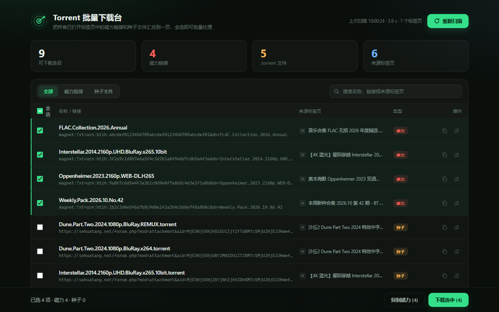

# Torrent Tab Detector

把浏览器里所有已打开标签页中的**磁力链接**和 **.torrent 种子链接**汇总到一个页面，全选即可批量下载或复制，不用再一个页面一个页面地找。



## 功能

- **一次扫描全部标签页**：识别页面中的 `magnet:` 链接、`.torrent` 文件、论坛附件链接（URL 本身不含 `.torrent`，靠链接文字 / `title` / `download` 属性识别）
- **批量处理**：全选后 `.torrent` 直接批量下载，磁力链接一次性复制到剪贴板，粘贴进 qBittorrent / Transmission 即可批量添加
- **自动去重**：磁力按 info hash 去重，种子文件按规范化 URL 去重
- **来源可追溯**：每条结果都能一键跳回来源标签页
- **全部本地运行**：不上传、不联网、无统计埋点

## 安装

### 从商店安装

> 尚未上架，上架后会在这里补充链接。

### 开发者模式加载（源码方式）

1. 下载本仓库（`Code → Download ZIP` 或 `git clone`）
2. 打开 `edge://extensions` 或 `chrome://extensions`
3. 打开「开发人员模式」
4. 点「加载解压缩的扩展」，选择本仓库根目录（包含 `manifest.json` 的那一层）

## 使用

- 点击工具栏图标查看本次扫描结果，点「批量管理」进入整页下载台
- 在下载台里用类型筛选 / 搜索框定位条目，勾选后点「下载选中」
- 磁力链接会先复制到剪贴板，`.torrent` 文件会直接进入浏览器下载
- 浏览器内部页面（`chrome://`、扩展页、应用商店页）无法被扫描，会列在「未能读取」里并注明原因

## 目录结构

```
manifest.json      # Manifest V3 配置
background.js      # Service worker：扫描调度、DOM/运行时检测、缓存
popup.html/css/js  # 工具栏弹窗
dashboard.html/css/js  # 批量下载台（options 页）
icons/             # 16/32/48/128 图标
privacy.html       # 隐私政策（可直接托管）
screenshots/       # 商店截图
```

无需构建步骤，原生 JavaScript，改完代码在扩展管理页点「重新加载」即可。

## 实现说明

扫描分两层，都只在用户点击扫描或打开批量页时执行：

| 层 | 作用 |
|---|---|
| `domScan`（ISOLATED world） | 遍历链接、资源元素、表单、内联脚本、页面文本，提取种子痕迹 |
| `runtimeScan`（MAIN world） | 检查页面全局对象里是否有 WebTorrent 之类的 BT 客户端痕迹 |

性能相关设计：

- 标签页并发 10，单页超时 5 秒，运行时扫描超时 1.5 秒
- 两层注入并行执行，DOM 扫描使用 `textContent` 而不是 `innerText`（避免强制同步布局）
- 60 秒内 URL 未变化的标签页直接复用缓存结果；手动点「重新扫描」会绕过缓存

## 权限说明

| 权限 | 用途 |
|---|---|
| `tabs` | 读取已打开标签页的标题和网址 |
| `scripting` + 全站访问权限 | 点击扫描后向页面注入一次性只读脚本 |
| `storage` | 本地缓存最近一次扫描结果 |
| `downloads` | 批量下载用户勾选的 `.torrent` |
| `clipboardWrite` | 批量复制磁力链接 |

## 隐私

扩展不收集、不上传任何数据，所有解析都在本地完成。详见 [privacy.html](privacy.html)。

## 免责声明

本工具只读取页面上**已经存在**的链接，不提供、不存储、不分发任何资源，也不绕过任何网站的登录或权限控制。请仅将下载结果用于你有权获取的内容，并遵守当地法律法规与目标网站的服务条款。
